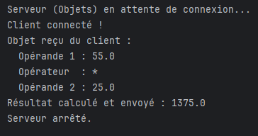
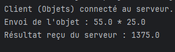

TP2 - Activité 2-2 : Échange d'objets entre Client/Serveur via les Sockets TCP

Description
Cette activité étend l'application pour permettre l'échange d'objets sérialisables (au lieu de chaînes de caractères).
Le client crée un objet `Operation` (implémentant `Serializable`), l'envoie au serveur. Le serveur reçoit l'objet, extrait les données, effectue le calcul et renvoie le résultat.

Structure ajoutée
- `src/communPackage/Operation.java` : Classe partagée implémentant `Serializable`.
- `src/serverPackage/ServerObjet.java` : Serveur utilisant `ObjectInputStream` et `ObjectOutputStream`.
- `src/clientPackage/ClientObjet.java` : Client créant et envoyant l'objet `Operation`.

Comment exécuter
1. Lancer `ServerObjet.java` en premier.
2. Lancer `ClientObjet.java`.

Captures d'écran

console du server 

console du client 

